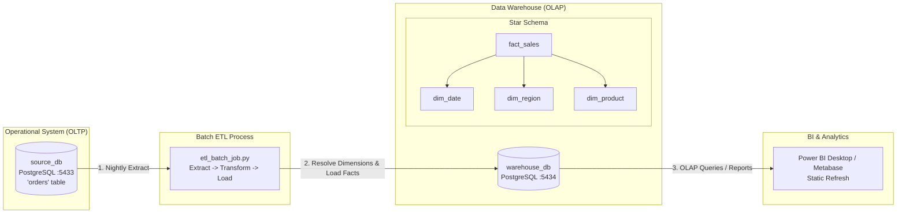

# Traditional Data Warehouse Lab Architecture & Guide

A practical, end-to-end implementation of a **Traditional Data Warehouse (DW)** leveraging **Batch ETL**, a **Star Schema** (Fact & Dimension tables), and **OLAP / BI Reporting**.

---

## 1. System Architecture



---

## 2. Quickstart Execution Guide

### Prerequisites
- Docker Desktop
- Python 3.x with `psycopg2-binary`:
  ```bash
  pip install psycopg2-binary
  ```

### Step 1: Start Databases with Docker Compose
```bash
docker compose up -d
```

### Step 2: Initialize the Source (OLTP) Database
```bash
docker exec -i source_db psql -U postgres < source_schema.sql
```

### Step 3: Initialize the Data Warehouse (Star Schema)
```bash
docker exec -i warehouse_db psql -U postgres < warehouse_schema.sql
```

### Step 4: Run the Batch ETL Job
```bash
python etl_batch_job.py
```

### Step 5: Test OLAP Queries
```bash
docker exec -i warehouse_db psql -U postgres < olap_queries.sql
```

---

## 3. Demonstrating "Batch Lag" (Core Architectural Concept)

1. Insert a new real-time order into the source database:
   ```sql
   INSERT INTO orders (customer_name, region, product, order_date, amount)
   VALUES ('Customer_NEW', 'North', 'Laptop', CURRENT_DATE, 99999);
   ```
2. Query the warehouse row count:
   ```bash
   docker exec -it warehouse_db psql -U postgres -c "SELECT count(*) FROM fact_sales;"
   ```
   *Notice that the new order is **not** visible yet, proving batch latency.*
3. Run the ETL script again (`python etl_batch_job.py`) and re-check the warehouse. The count increases only after the batch execution.

---

## 4. BI Dashboard Setup (Power BI / Metabase)

### Power BI Desktop
1. **Get Data** $\rightarrow$ **PostgreSQL Database**
2. **Server**: `localhost:5434`, **Database**: `postgres`
3. **Credentials**: User `postgres`, Password `dw123`
4. Load `fact_sales`, `dim_date`, `dim_region`, `dim_product`.
5. Verify schema relationships in Model view and build visuals (Bar chart for sales by region, table by product, date slicer).
